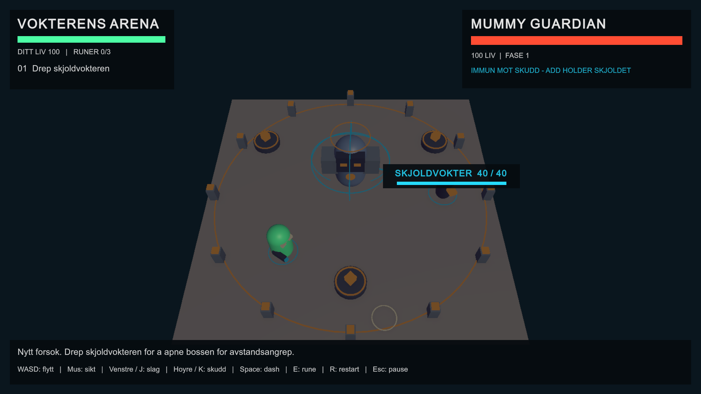

# BOSS-001: playable visual sandbox

Open `Assets/_Sandbox/SparkBossFramework001/Scenes/Spark_BossFramework_001.unity` in Unity and press Play. Click the Game view to enable input.

## Controls
- WASD / arrows: move.
- Mouse: aim.
- Left mouse / J: melee.
- Right mouse / K: ranged projectile.
- Space: dash.
- E: activate nearby rune.
- R: restart. Esc: pause.

## Encounter
Kill the cyan Shield Keeper to remove the boss's ranged immunity. Melee bypasses this ranged-only shield. At 70% boss health, a separate rune shield blocks attacks until all three runes are activated. Dodge the boss's telegraphed area attacks.

The prototype includes geometric boss/player details, shield rings, an energy tether, visible projectiles/trails, damage feedback, targeting markers, health bars and encounter objectives. This is prototype art, not finished production artwork.

## Recorded local tests
These results were recorded before publication in Unity 6000.5.8f1 on local branch Martin, commit f35a74e302ab00d95adb48d26b81f2feccaec06d plus the sandbox files and existing user changes. They are not CI results or results from a clean checkout of this PR.

- EditMode: 26 passed, 0 failed, 0 skipped.
- Controlled Play Mode: 12 checks passed.
- Melee bypasses ranged shield; a living add blocks boss ranged damage.
- Projectiles hit the moving add; add death removes ranged immunity.
- Ranged attacks damage the unshielded boss and trigger the 70% health phase transition.
- The separate rune shield blocks ranged damage; activating three runes allows a ranged victory.
- Restart restores the encounter and removes old projectiles.
- A visible projectile is spawned by the ranged command.
- No Unity console errors at the final check.
- Screenshot visually inspected.
- Physical keyboard/mouse operation and a standalone exported build were not tested.

## Isolation and review notes
Only the sandbox files and their parent folder metadata are included. Documentation and screenshot are inside Documentation~, which Unity ignores as an asset directory. No production scenes, packages or project settings are changed.

This publication is based on GitHub main at 0f9e28c92e4ff3552546c6cdbb5bc9887318e2a8, which differs from the local tested project. The remote main already declares Input System, URP and Unity Test Framework dependencies. Compatibility with a clean checkout of the PR must still be tested before merge.

For the visual/ranged extension, 2006 entries outside the sandbox were unchanged against its fresh before snapshot. QualitySettings.asset was already locally changed before that extension and is excluded from this PR. The original whole-task historical safety gate remains PARTIAL because the first baseline lacked content hashes for 27 tracked entries. Do not interpret the fresh extension check as a complete historical safety PASS.

Specification: Martinpy97/kunnskapsnettverk, spark-boss-sandbox-task, commit df1a328e0ccd512ee0eef6c6635544df3c7eac09, START_HER_SPARK_BOSS_SANDBOX.md and SPARK_BOSS_SANDBOX_001.md.
